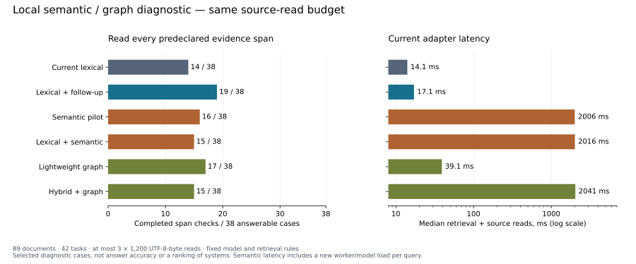

# Local semantic and graph diagnostic

[한국어](PRACTICAL_VARIANTS.ko.md)

Tested 2026-10-15. **There are useful recoveries, but this trial does not justify
adding either method to default retrieval.** A cheap source-based follow-up
outperformed the prepared semantic model and lightweight graph on the fixed
span checks. This is evidence about these prototypes and cases, not semantic
retrieval or graph memory in general.



## Conditions

The fixed fixture has 89 documents, 109 chunks, 129 embedding windows and 42
questions: 38 have predeclared evidence requirements; four are unanswerable.
Most documents are synthetic project/operations notes; two questions inspect
this repository's real `search.py`. All operational memories stay out of the
experiment. Questions, expected paths and evidence needles are never indexed.

Each variant receives 4,000 search-output bytes and at most three source reads
of 1,200 bytes each, including provenance. A check passes only if every
predeclared literal span is actually fetched from its expected canonical file.
This deliberately goes beyond a document-ID hit, but **does not grade answer
accuracy**. Equivalent evidence in another passage can be undercounted. No LLM
reader/judge was run. The cases deliberately exercise known gaps and are not a
representative sample of user tasks.

Models, extraction rules, rank weights, cases and answer checks were not tuned
to failures. The first run displayed up to 20 candidates; a declared sensitivity
run used the agent contract's normal limit of three. Both are retained. In the
broad display, distinct-file reservations hid a second code chunk: lexical
completion was 13/38 rather than 14/38. Other variant totals were unchanged.
Use the three-candidate workflow below; this is not a replacement metric or a
claim that a higher score made the change acceptable.

## Results at the normal three-candidate limit

| Variant | All declared spans / 38 | Paraphrase / 12 | Two-source / 8 | Three-source / 4 | Public code / 2 | Median / p95, ms |
|---|---:|---:|---:|---:|---:|---:|
| Current lexical | 14 | 1 | 0 | 0 | 1 | 14.1 / 22.1 |
| Lexical + one source-based follow-up | 19 | 0 | 7 | 0 | 0 | 17.1 / 28.5 |
| Existing semantic pilot | 16 | 2 | 2 | 0 | 0 | 2,006 / 2,522 |
| Equal-weight lexical + semantic RRF | 15 | 2 | 1 | 0 | 0 | 2,016 / 2,535 |
| Lightweight passage/entity graph | 17 | 1 | 3 | 1 | 0 | 39.1 / 49.7 |
| Hybrid + the same graph | 15 | 2 | 1 | 0 | 0 | 2,041 / 2,559 |

All variants passed the eight literal file/ID cases and four ambiguity/version
cases. That is a small control set, not proof of disambiguation or event-time
reasoning. The follow-up heuristic can replace useful original candidates, so
it also regressed on two cases the single search completed. It is not a capable
agent's best possible behavior.

Compared with single lexical search, semantic retrieval recovered four cases
and lost two; the graph recovered four and lost the real code definition/call
case. Compared with the follow-up baseline, semantic recovered two and lost
five; the graph recovered two and lost four. See paired case IDs in the
[complete result](results/practical-variants-top3.json).

Concrete benefits and failures:

- Semantic retrieval found the recovery-copy retention value for “restore an
  older snapshot” and the mouse-free checkout/focus-ring rule for a keyboard
  question. All seven cross-language paraphrase cases missed their declared
  spans with this prepared model. That does not establish other models' limits.
- The graph connected Iris → Solstice → LarkQueue → nine-day retention, which
  the fixed one-follow-up baseline did not complete. Its two-source result was
  3/8, compared with 7/8 for the cheaper follow-up. Surface-form extraction
  misses unmarked Korean names and merges ambiguous names/hubs.
- Equal RRF fusion can displace an exact code span; combining more channels
  did not preserve the definition/call-site pair in this fixture. A file-level
  retrieval score would hide this failure.
- On four absent-answer questions, semantic variants still made 12 source
  reads; lexical/graph variants made nine. These are unnecessary candidates,
  not measured hallucinations: no answer was generated or abstention calibrated.

## Cost and the cold-worker limitation

The existing semantic pilot runs a new Python/model worker and fingerprints its
model files for every query. Its roughly two-second latency must not be treated
as an inherent embedding cost. A separate resident-model timing probe produced
the same top-three document paths on all 42 queries:

OS file caches were not purged. This is not a cold-disk or concurrent-throughput
measurement; “cold worker” means a new inference process.

| Measurement | Result | Includes |
|---|---:|---|
| Resident model startup | 1,324 ms | Imports, model load and vector load |
| Resident query median / p95 | 6.5 / 8.2 ms | Embedding + vector ranking only; excludes source checks, fingerprinting and fetch |
| Resident worker peak RSS | 1.19 GiB | One process, observed peak during this probe |
| Current cold semantic process-tree peak | 1.36 GiB | Sampled runner + model worker |
| Lexical / graph sampled process-tree peaks | About 30 MiB | Shared small fixture process, not incremental graph memory |

The graph took 26 ms to construct and serialized to 18.1 KiB. Semantic vector
construction took 12.4 seconds and produced 192 KiB of state, in addition to
about 465 MiB of pre-existing model files. This tiny corpus does not establish
construction/validation cost at production scale. The graph currently validates
its eligible snapshot before every traversal; that also needs scale work.

The first broad run had a memory-sampling phase race; its per-phase memory
numbers are excluded. The normal-limit run fixes phase attribution and charges
combined methods the reused semantic call's latency and peak memory. Sampling
can miss short peaks and count shared pages twice. The exact memory increment
of each method was not isolated in separate parent processes.

Core: Python 3.9.6, macOS arm64, eight logical CPUs. Semantic worker: Python
3.14.6, FastEmbed 0.9.0, ONNX Runtime 1.31.0, tokenizers 0.23.3, NumPy 2.5.4,
four inference threads. No model/runtime download or LLM API was used for
inference. The pinned ONNX weight checksum matched the official revision's LFS
metadata. Plot dependencies were isolated from both engine runtimes.

## Scope, integrity and adoption

Live inference checks passed stale-source rejection and collection isolation.
The graph reapplies review/project/shareability eligibility before traversal,
including when an old snapshot contains excluded cards. The semantic pilot
**rejects curated-memory collections**; this is a guard, not support for their
project/domain/sensitivity policies. A semantic vault backend remains unproven.

Keep production defaults and operational data unchanged. Retain optional semantic
research use, and source-based follow-ups for a named gap. Before a default
semantic backend, validate a broader task sample, source-span delivery, negative
queries, a persistent worker and vault policies. Before a graph backend, show
that reliable entity/link extraction and typed provenance beat ordinary
follow-ups at realistic corpus size. Do not tune this set to get those results.

The graph here is automatic surface-form co-occurrence plus Personalized
PageRank (restart 0.15, 30 iterations). It is **not a direct run of Graphiti or
HippoRAG 2**, does not extract factual triples and has no temporal reasoning.
[HippoRAG 2](https://arxiv.org/abs/2502.14802) is a design reference, not a result
baseline. Model use follows the pinned [E5 model card](https://huggingface.co/intfloat/multilingual-e5-small/blob/614241f622f53c4eeff9890bdc4f31cfecc418b3/README.md).

## Reproduce

With the optional pinned runtime/model already prepared in a private home:

```bash
.venv/bin/python -m benchmarks.practical_variants \
  --workspace "$HOME/.cache/agent-memory-benchmarks/my-variants-run" \
  --semantic-home /absolute/path/to/private-memory --display-limit 3

/absolute/path/to/private-memory/runtime/semantic/bin/python -I \
  benchmarks/semantic_warm_probe.py \
  --workspace "$HOME/.cache/agent-memory-benchmarks/my-variants-run" \
  --model /absolute/path/to/private-memory/runtime/models/multilingual-e5-small
```

Use a new workspace outside the checkout. The runner links existing runtime/model
files read-only in practice, writes a separate private index, and never changes
operational sources or default settings. Hashes and fixed requirements are saved
before inference. Equal-score opaque IDs depend on source roots, so another root
can change ties. See [the protocol](PRACTICAL_VARIANTS_PROTOCOL.md),
[normal-limit records](results/practical-variants-top3.json),
[broad-limit records](results/practical-variants-broad20.json), and
[resident-model probe](results/practical-variants-warm.json).
