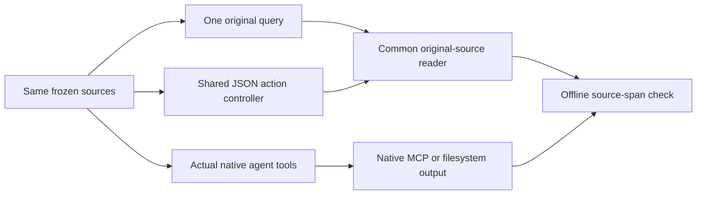

# Actual external-system comparison, 2026-10-15

[한국어](SYSTEM_COMPARISON.ko.md)

The useful directions are **better original-source navigation** and **optional
semantic recall**. The tested graph, extracted-fact and reranking configurations
do not justify replacing the default lexical engine. This is a small adoption
diagnostic, not an upstream leaderboard or a claim about general agent quality.

We ran actual upstream code for qmd, HippoRAG 2, Graphiti, Mem0 OSS, Letta Code
and Sourcegraph's SCIP Python indexer. SCIP is a code-navigation component, not
a general memory system. Graphiti required the recorded FalkorDB query-syntax
compatibility fix below. The current engine and operational memory were not
changed. None of these packages became a core runtime dependency.

## What the numbers mean

The metric asks whether the reader received **every predeclared original-source
span**. Extracted facts, similar snippets, filenames and final answers do not
substitute for source evidence. This is **not answer accuracy**. A useful partial
explanation can fail this strict check, while reading all spans does not prove a
correct answer.
The automatic check uses literal source anchors in returned canonical text,
such as a definition and a call-site line. It does not verify that a complete
function body was read or that the collected evidence suffices for every aspect
of the answer.

The frozen pool contains 93 synthetic/public documents and 122 core chunks.
There are 50 questions: the previous 42 (38 positive, four absent-answer) and
eight new public-source questions. The additional questions were fixed before
inference. They are a small practical diagnostic, not a representative held-out
population. Published hashes identify the exact pool. The original questions
now compete with additional source files, so differences from the earlier
42-question run are not a directly comparable percentage change.

Three different workflows are reported separately:

Single-query runs display up to three candidates within 4,000 UTF-8 bytes and
read up to three 1,200-byte original spans. The shared controller uses the first
two positive cases per old category, all four absent cases, and all eight new
cases: 24 questions, 20 positive. It gets six searches, eight JSON decisions,
1,200 bytes per search within 4,000 total, and three 1,200-byte reads. It sees no
expected evidence, answer labels or corpus files outside tool observations.

General LLM extraction and agent/controller decisions used the user's requested
ChatGPT-plan Codex CLI, `gpt-6.1-sol`, low reasoning. qmd retained its native local
GGUF query-expansion and reranking models as separately listed dependencies.
The Codex adapter uses documented `codex exec`; credentials
stay with the CLI. Native API temperature/max-token fields are not exact CLI
decoding controls. This does not reproduce the papers' LLM configurations.

## One original query, common reader

| Tested configuration | Original positives /38 | New public-source /8 | Total /46 | Different wording/language /12 | Three-source chain /4 | Original code /2 |
|---|---:|---:|---:|---:|---:|---:|
| Current lexical | 13 | 2 | 15 | 0 | 0 | 1 |
| Lexical + exact-symbol SCIP prototype | 13 | 2 | 15 | 0 | 0 | 1 |
| qmd full: expansion + hybrid + rerank | 25 | 1 | 26 | 12 | 0 | 0 |
| qmd vector only | 25 | 2 | 27 | 11 | 0 | 0 |
| qmd hybrid, no expansion/rerank | 25 | 1 | 26 | 11 | 0 | 0 |
| qmd lexical, raw natural-language query | 0 | 0 | 0 | 0 | 0 | 0 |
| HippoRAG 2 | 16 | 2 | 18 | 3 | 0 | 0 |
| Graphiti native RRF + compatibility fix | 17 | 2 | 19 | 3 | 0 | 0 |
| Mem0 minimal, missing optional retrieval extras | 20 | 1 | 21 | 5 | 0 | 1 |
| Mem0 + native BM25 backfill | 16 | 1 | 17 | 4 | 0 | 0 |

qmd's lexical API returned no candidates for these full natural-language
questions. Separate focused-keyword smoke checks (`parse_ref`, `INC-7842`)
returned the correct files. This is a raw-query/API mismatch, not an installation
failure or evidence that BM25 cannot work. The common-controller experiment is
the separate test of query rewriting. qmd's own
[skill](https://github.com/tobi/qmd/blob/86d2365d17fc682e491c2c53d1e4a884aee8682a/skills/qmd/SKILL.md)
also recommends agent-written lexical/semantic fields. We did not run every
possible native-agent/model configuration or claim these are upstream optima.

Vector-only qmd recovered 13 previously incomplete cases and lost one code case
relative to lexical. The full three-model pipeline did not beat vector-only on
this source-completeness check. That makes semantic candidates worth further
testing; it does not justify copying every stage or treating one extra success
as statistically established superiority.

The Mem0 BM25 backfill updated sparse vectors for 257 stored memories. IDs,
fact text and source linkage stayed unchanged (fact hash in the receipt). Its
lower result is retained. Optional entity enrichment was missing during initial
ingestion, so this is not a fully enabled, best-possible Mem0 configuration.
No weights were adjusted after observing the regression.

## Same JSON controller, same original-source reader

| Backend | Complete evidence /20 | Different wording /2 | Two-source /2 | Three-source /2 | Original code /2 | New public-source /8 |
|---|---:|---:|---:|---:|---:|---:|
| Current lexical | 13 | 2 | 2 | 2 | 0 | 3 |
| Lexical + SCIP prototype | 13 | 2 | 2 | 2 | 0 | 3 |
| qmd full | 11 | 2 | 2 | 2 | 0 | 1 |
| HippoRAG 2 | 13 | 2 | 2 | 2 | 0 | 3 |
| Graphiti + compatibility fix | 12 | 1 | 2 | 2 | 0 | 3 |
| Mem0 + BM25 | 15 | 2 | 2 | 2 | 0 | 5 |

Literal-ID and ambiguity tasks were 2/2 each for the completed rows above.
The two selected three-source questions became solvable through explicit
query rewriting and source-named follow-ups even with lexical search. This is
two selected cases, not proof that all multi-hop tasks need no graph.

Mem0 gained three new public-source cases and lost one relative to lexical;
HippoRAG changed which public-source tasks passed without increasing the total.
Record those useful recoveries and losses rather than adopting a framework from
the total alone. This controller sometimes spent its decisions retrying invalid
or exhausted reads and ended without a final answer. The reported score remains
source delivery, not successful task completion.

## Actual native agent tools

| Native workflow, same 24 questions | Complete evidence /20 | Original code /2 | New public-source /8 | Output conditions |
|---|---:|---:|---:|---|
| Codex + actual core memory MCP | 11 | 0 | 3 | Same search/read byte caps; native tool loop, 240-second watchdog |
| Letta Code, Read/Grep/Glob only | 20 | 2 | 8 | Original demonstration; requested 3 reads of 15 lines, unequal byte budget |
| Letta Code with capped visible output | 18 | 2 | 7 | Six searches, 4,000 search bytes; first 3 reads, 1,200 bytes each |

The capped Letta arm missed one expression task and one public-source scope
task. It had no unexpected tool types. Its source checker verifies live grep
path, line number and unchanged canonical line text; filenames alone do not
pass. The uncapped arm's largest tool output was 13,139 bytes and cannot be
ranked against the common-budget rows.

Even matched byte caps do not make the native interfaces identical. Live grep
returns canonical source lines that can serve as evidence, whereas cached index
snippets in the core contract require a validated fetch. Native Letta may execute
an excess tool attempt whose output is withheld. Prompts, tool schemas, native
turn semantics and decoding paths also differ. The result concerns the complete
tested workflow, not a causal advantage of one model or memory algorithm.

The native Codex run exposed a concrete core interface weakness: `max_tokens`
does not explain its UTF-8-byte units in the MCP property, and small requested
budgets can leave almost no code after provenance. Focused reads may land on a
repeated symbol rather than the exact implementation line. These are source
navigation and tool-usability issues. Adding a graph would not itself fix them.

## What to adopt

| Priority | Decision | Practical basis and acceptance condition |
|---|---|---|
| First | Improve original-source navigation and tool descriptions | Explain byte units, chunk refs and continuation clearly. Prototype source-bound line search and precise line-range reads with current-source validation. Check that a reader can inspect a definition and its caller without repeated empty/tiny reads. Preserve scope/status/version checks and existing byte caps. |
| Keep | Query rewriting, translation and explicit named follow-ups | These already recover selected expression and three-source tasks without changing the index. Show readable tool flows and preserve the earlier evidence. Do not hardcode benchmark aliases or infer unknown relationships. |
| Next, optional | Improve the semantic candidate channel | Test model-window-aware embedding chunks and alternative local representations. qmd's tested configuration helps wording/language mismatch. Keep literal IDs available, verify original sources, and test policy isolation, resource use and real user questions before default fusion. |
| Defer default adoption | Full graph/fact extraction pipeline | Extra indexing/inference and operating complexity need consistent useful gains and preserved provenance. The current small task pool does not test the full temporal/history strengths of Graphiti or long-conversation personalization of Mem0. |
| Defer default adoption | Automatic reranking/expansion and SCIP prepending | The qmd component check did not demonstrate incremental practical value for the full pipeline. SCIP produced real locations (37 defined functions, 24 with references), but this chunk-mapping integration did not improve completed evidence. Exact symbol navigation may still be valuable as an explicit tool. |

This selects implementation directions. It does **not** silently deploy a
new default, capture conversations, promote extracted facts, or change the
operational memory home. Final acceptance needs real authorized tasks and a
fresh evaluation that was not used to design the changes.

## Configuration and cost limits

HippoRAG, Graphiti and Mem0 used the same local multilingual E5-small transport
with query/passage prefixes and normalized mean pooling. qmd used its own native
embeddinggemma-300M, query-expansion-1.7B and Qwen3-reranker-0.6B GGUF models,
about 2.26 GB total downloaded model bytes. All three hashes were verified.
Different embedding models and native chunking prevent an algorithm-only causal
comparison.

HippoRAG used its native indexing/retrieval with only LLM/embedding transport
overrides. Graphiti used text episodes dated 2026-10-15 and native edge BM25,
cosine and BFS search fused by RRF, without a cross-encoder. Native episode IDs
map back to source chunks. Its displayed score is a reciprocal native-rank proxy;
the native result order is retained, and the value is not a confidence score.
Mem0 used inferred memories from each source chunk,
dedicated user filtering and local Qdrant; stored source IDs lead back to the
original reader. This document corpus does not cover every system's intended
conversational or temporal use case.

A post-hoc input check found that 30/122 core chunks exceed E5's 512-token
window, including 28/34 Python chunks (maximum 846 tokens). This identifies a
plausible configuration problem for direct passage embeddings, including
HippoRAG's passage channel. Graphiti and Mem0 also embed shorter extracted
entities/facts; this source-length check does not describe all their actual
embedding inputs or their LLM extraction context. It does not prove which failed answers it
caused. We preserved the scored inputs and did not split/retest them to increase
the result. Fixing the representation deserves a new experiment.

Measured native build wall times were about 24.3 minutes for HippoRAG and
56.1 minutes for Mem0. Graphiti's final successful compatibility retry took
21.80 seconds with the prior failed build's inference cache; this is not its
uncached ingestion cost. They include the shared two-slot Codex queue and
concurrent work; they are not isolated hardware
speed rankings. qmd's original build timing was accidentally overwritten by a
reload measurement and is unavailable. A separately declared fresh-DB probe with
already downloaded model files took 10.34 seconds: 0.14 scan and 10.17 embedding
plus model load. It excludes download, query expansion and reranking.

No attributable whole-phase peak RSS was measured. Do not invent a memory
ranking. Per-read time and every model's startup time were not independently
instrumented; controller elapsed time combines inference, search and reads.
The machine-readable receipt includes retrieval times under the recorded cache conditions,
native build times and actual unique Codex calls/tokens. Cache hits are not
counted as new CLI invocations. These counts include setup and preserved trials;
they are account usage, not a separate API bill. Stateless CLI calls also carry
the CLI's own base context, so these token counts are not minimum API costs.
Native Letta's zero streaming
usage fields are not used to claim free inference.

## Failures and evaluation integrity

The following setup/adapter failures were kept privately and corrected before
their affected final trials. They are not scored as retrieval failures:

- Graphiti's Kuzu path hit an upstream `_database` backend error. The run used
  supported FalkorDB Lite instead. An initially supplied episode UUID had the
  native meaning “existing episode”; the adapter was fixed to accept generated
  IDs and map episodes back to source IDs. A missing `httpx` dependency was added.
  Unmodified FalkorDB then rejected a fulltext query containing a standalone
  `_` atom during bulk resolution. A benchmark-only driver removes
  punctuation-only atoms after native sanitization, including per-group clones;
  it retains words, native ranking and graph flow. All 389 extracted facts
  passed a direct syntax check. Failed states were archived; the retry used
  fresh graph state and the existing exact-request inference cache. This is a
  compatibility-corrected native run, not unmodified upstream or a fresh
  uncached build measurement.
  Embedded async cleanup also lost the in-memory database before a new worker
  reloaded it. The final adapter explicitly saves native state and verifies its
  episode count; an empty reload and an overlapping shutdown/startup attempt
  were excluded. The first valid single-query pass and the final persisted pass
  both scored 19/46, with no changed success labels.
- The initial Letta transport reused tool-call IDs and had incomplete timeout
  cleanup. Unique IDs and a process-group watchdog fixed execution. The first
  native Codex MCP setup lacked non-interactive read-tool approval metadata;
  no source had been read in that setup trial. Read-only annotations and
  per-invocation metadata fixed it.
- The common controller originally displayed all candidates as rank 1. The
  lexical baseline was rerun with correct rank labels. A SCIP adapter initially
  parsed `foo.py` as the function `foo`; generic tokenization and a separate
  filename regression check fixed that routing bug. Prior trials were retained.
- Scorers check actual original-source text. Gold requirements never enter an
  extraction/indexing prompt, agent context or source mapping. Corrections to
  scorer path parsing were verified against real and fabricated canonical lines.
  UTF-8 tail caps and repeated tool-return IDs have integrity tests.

A native-tool path audit found one uncapped Letta Glob attempt in the isolated
empty inference directory outside the source pool; it returned no source content.
The other audited Read/Grep/Glob paths stayed within the synthetic/public source
root. No claim of an enforced filesystem sandbox follows from this path audit.

The original code question about `_focus_span` requires both its definition and
call site. A reasonable explanation may need fewer spans, so a strict failure
must not be advertised as a wrong answer. Conversely a complete read can still
lead to a wrong explanation. No answer-quality judge or population estimate is
claimed. Absent-answer questions have no positive-source score; read counts and
answers need separate review. This pool also does not establish permission,
cross-user isolation, temporal reasoning or production scalability of upstream
systems.

## References and artifacts

The actual mechanisms are documented upstream:
[qmd](https://github.com/tobi/qmd),
[HippoRAG 2](https://arxiv.org/abs/2502.14802),
[Graphiti](https://github.com/getzep/graphiti),
[Mem0 OSS](https://github.com/mem0ai/mem0),
[Letta Code](https://github.com/letta-ai/letta-code), and
[SCIP Python](https://github.com/sourcegraph/scip-python).
Graphiti OSS is not managed Zep; Mem0 OSS is not the hosted platform; this run
of Letta Code is not a reproduction of an earlier Letta blog's complete setup.
These are comparison references, not new upstream code bases for this engine.

- [Compact results and pinned identities](results/system-comparison-2026-10-15.json)
- [Main protocol](SYSTEM_COMPARISON_PROTOCOL.md),
  [qmd component check](QMD_ABLATION_PROTOCOL.md),
  [SCIP integration](SCIP_INTEGRATION_PROTOCOL.md),
  [Letta matched caps](LETTA_BUDGET_PROTOCOL.md),
  [actual Codex MCP](NATIVE_CODEX_PROTOCOL.md)
- [Reproduction guide](SYSTEM_COMPARISON_REPRODUCE.md)

Raw model transcripts, local configuration, authentication, upstream checkouts,
model files, indexes and operational memory are excluded from the public repo.
