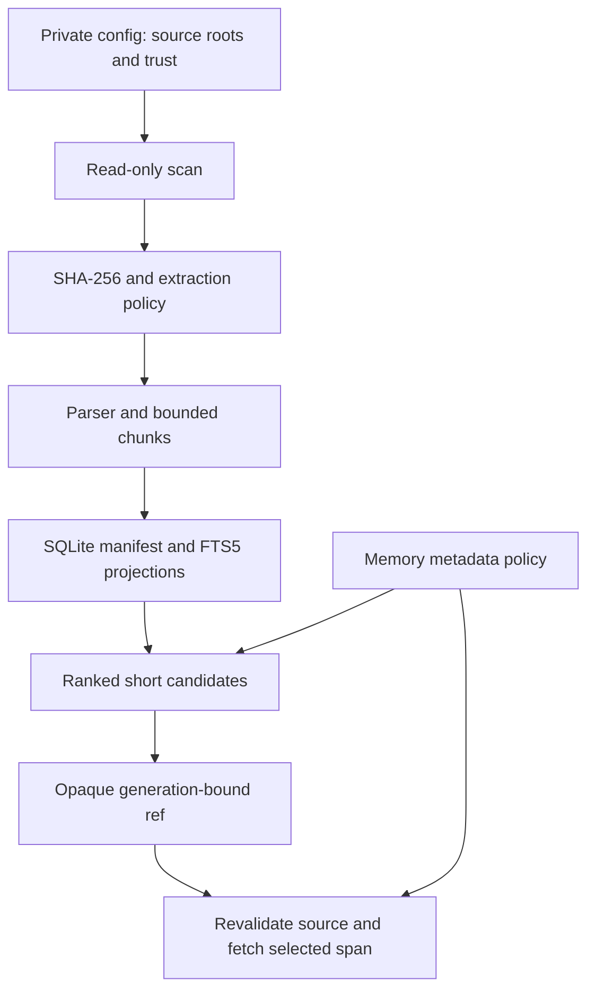

# Architecture

The engine reads configured source trees and builds replaceable search indexes.
Canonical files remain the source of truth. The same local CLI can serve several
agents without tying the memory home to an agent account or a model provider.

## Storage boundaries

| Location | Purpose | Distributed? |
|---|---|---|
| Source repository | Engine, tests, integrations, synthetic examples | Yes |
| Private `config.json` | Source paths and local options | No |
| Configured source trees | Canonical documents and project files | No |
| Private `vault/` | Explicitly captured and reviewed memories | No |
| Private `.state/` | Disposable SQLite and optional vector projections | No |
| Private `feedback/` | Durable opt-in retrieval failure queue | No |
| Private `runtime/` | Optional local semantic dependencies and models | No |

The default private home is `~/.local/share/agent-memory`. `AMEM_HOME` and
`--home` can select another directory. Configuration resolution does not depend
on the checkout, current working directory, or Python's site-packages location.

## Index and retrieval

Source policy, content hashes, extraction versions, and chunking versions bind
the index to the source generation. Incremental sync updates changed files and
removes missing ones only after a complete scan. Incomplete traversal preserves
unvisited records and fails the freshness gate.

FTS5 word and CJK character searches are combined using reciprocal rank fusion.
One/two-character substring fallback is restricted to CJK terms. Short Latin
function words use the word index; they do not add scan-order substring votes.
Path hints also omit short Latin words. Exact filename navigation
and trigram/compact candidates remain available.
Collection and reviewed-memory filters apply before result limits. Fetch checks
the generation, file hash, current source policy, and memory policy again.
Deleted or changed sources cannot be read with old references.

The document parser supports text, code, HTML, PDF, and selected Office/XML
formats. Archive expansion has a size limit. Extraction does not include OCR.
Optional Python AST chunking groups functions and classes when it can do so
without losing source coverage.

## Interfaces

The CLI is the stable interface. The shell launcher resolves its own location,
uses the checkout's private venv, and removes hostile Python path overrides.
An installed wheel supplies the same `amem` console command without the shell.

A shared agent skill calls the CLI on demand. The optional stdio MCP exposes
`memory_catalog`, `memory_search`, and `memory_fetch`. Neither interface preloads
the corpus into each conversation.

Bounded plain search reserves metadata and short snippets for distinct source
documents before expanding snippets. It shows a canonical `source-root` once
and relative paths below it, along with opaque refs, locators, trust, and memory
warnings. Repeated chunks of one file do not displace another file's first
pointer. JSON and unbounded search retain the full chunk candidate list; reads
retain full canonical paths. Existing 4,000-byte CLI and 6,000-byte MCP limits
remain in force.

## Lifecycle and freshness

Capture writes candidates to the inbox only after an explicit user request.
Review, promotion, conflict handling, and supersession remain manual. The
default memory policy accepts reviewed global cards. Project/domain access and
inbox review require explicit filters.

`ensure-fresh` measures time since the last successful local reconciliation.
It does not inspect edits after that reconciliation or revalidate upstream facts.
Use targeted `sync` for a known edit, and independently verify volatile claims.

SQLite and FTS5 secure deletion require SQLite 3.42.0 or newer. `compact`
checks and rewrites the active index; older copies and external backups have
separate retention. The optional semantic pilot is a separate local projection,
never the default search channel.
