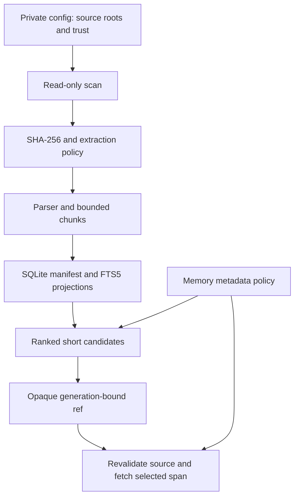

# Architecture

The engine reads configured source trees and builds replaceable search indexes.
Canonical files remain the source of truth. The same local CLI can serve several
agents without tying the memory home to an agent account or a model provider.

## Storage boundaries

| Location | Purpose | Distributed? |
|---|---|---|
| Source repository | Engine, tests, integrations, synthetic examples | Yes |
| Private `config.json` | Source paths and local options | No |
| Configured source trees | Canonical documents and project files | No |
| Private `vault/` | Explicitly captured and reviewed memories | No |
| Private `.state/` | Disposable SQLite and optional vector projections | No |
| Private `feedback/` | Durable opt-in retrieval failure queue | No |
| Private `runtime/` | Optional local semantic dependencies and models | No |

The default private home is `~/.local/share/agent-memory`. `AMEM_HOME` and
`--home` can select another directory. Configuration resolution does not depend
on the checkout, current working directory, or Python's site-packages location.

## Index and retrieval

Source policy, content hashes, extraction versions, and chunking versions bind
the index to the source generation. Incremental sync updates changed files and
removes missing ones only after a complete scan. Incomplete traversal preserves
unvisited records and fails the freshness gate.

FTS5 word and CJK character searches are combined using reciprocal rank fusion.
One/two-character substring fallback is restricted to CJK terms. Short Latin
function words use the word index; they do not add arbitrary substring votes.
Path hints also omit short Latin words. Exact filename navigation
and trigram/compact candidates remain available.
Chunk IDs, not index insertion order, decide ties within a channel and which
short CJK substring matches enter it. Editing and restoring a file, or
rebuilding `.state/`, therefore keeps the same results. Chunk IDs include the
absolute path, so another home or source location can still change ties.
Collection and reviewed-memory filters apply before result limits. Fetch checks
the generation, file hash, current source policy, and memory policy again.
Deleted or changed sources cannot be read with old references.

When rejected candidates underfill a search and a channel reaches its limit,
the engine refills under the same SQLite snapshot and memory policy, up to three
rounds and 640 candidates per channel. Source validation is cached only within
that request; reads still validate again. Diagnostics identify an exhausted
refill budget. Identical channel SQL results share one query while retaining
their separate RRF votes, and candidate rows are fetched in bounded batches.

The document parser supports text, code, HTML, PDF, and selected Office/XML
formats. Archive expansion has a size limit. Extraction does not include OCR.
Optional Python AST chunking groups functions and classes when it can do so
without losing source coverage. Markdown, Org, and reStructuredText files are
sectioned at `#` headings outside fenced code blocks, so comments inside a
code block do not split it or name a section. A change to a file type's
chunking or extraction policy hides its documents, and fails their old refs as
stale, until the next `amem sync` re-indexes them. `status` lists such rows as
`outdated_documents` and reports the index as not fresh, and `ensure-fresh`
re-syncs a collection that has them even within its age SLA.

## Interfaces

The CLI is the stable interface. The shell launcher resolves its own location,
uses the checkout's private venv, and removes hostile Python path overrides.
An installed wheel supplies the same `amem` console command without the shell.

A shared agent skill calls the CLI on demand. The optional stdio MCP exposes
`memory_catalog`, `memory_search`, `memory_fetch`, and `memory_locate`. By
default all four are annotated as read-only and closed-world. When opt-in
zero-result feedback is enabled, `memory_search` is listed as not read-only
because it can append a private feedback row. Neither interface preloads the
corpus into each conversation.

Bounded plain search reserves metadata and short snippets for distinct source
documents before expanding snippets. It shows a canonical `source-root` once
and relative paths below it, along with opaque refs, locators, trust, and memory
warnings. Repeated chunks of one file do not displace another file's first
pointer; additional chunks are included when space remains, so complementary
sections of one document remain discoverable. Selected hits appear in their
original rank order. JSON and unbounded search retain the full chunk candidate list; reads
retain full canonical paths. Existing 4,000-byte CLI and 6,000-byte MCP limits
remain in force. Context blocks also start with the full canonical path and ref
and spend the rest of their share on a literal source window. Results that do
not fit are listed as omitted refs instead of being shown without source text.

## Lifecycle and freshness

Capture writes candidates to the inbox only after an explicit user request.
Review, promotion, conflict handling, and supersession remain manual. The
default memory policy accepts reviewed global cards. Project/domain access and
inbox review require explicit filters.

`ensure-fresh` measures time since the last successful local reconciliation
and also re-syncs when indexed rows predate the current parser, chunk policy,
or card validation. It does not inspect edits after that reconciliation or
revalidate upstream facts.
Use targeted `sync` for a known edit, and independently verify volatile claims.

SQLite and FTS5 secure deletion require SQLite 3.42.0 or newer. `compact`
checks and rewrites the active index; older copies and external backups have
separate retention. The optional semantic pilot is a separate local projection,
never the default search channel.
