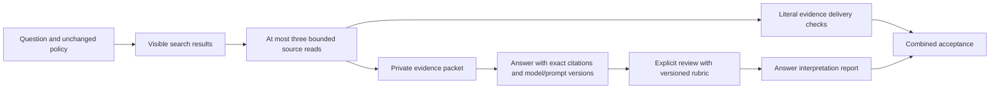

# Continuity evaluation and capture retry protection

Implemented in the source tree. The five continuity fixtures are synthetic;
no operational gold queries, source documents or real memory cards are changed.
The answer harness runs offline and requires explicit semantic review. It does
not claim to measure model accuracy from retrieval hits.

## Separate the two evaluation layers



| Fixture | Source evidence | Answer review |
|---|---|---|
| Proposal and decision | Assistant proposes SQLite; user approves PostgreSQL | Preserve attribution and approval |
| Related material without approval | Deployment proposal; no approval in the complete fixture record | Limit the conclusion to what is established |
| Changed decision | Dated decisions, explicit replacement, both rationales | Select the current decision and preserve history |
| Unresolved conflict | Two incompatible launch dates; no resolution | Disclose the conflict |
| Partial enumeration | Two visible events; authoritative inventory of four | Separate visible subset, total inventory and unknown outcomes |

Create a new, synthetic-only home from the repository:

```sh
.venv/bin/python scripts/evaluate_continuity.py --home /tmp/amem-continuity-demo
```

The command refuses an existing nonempty home. It creates
`eval/continuity.jsonl` and `eval/evidence.json`, and prints the delivery report.
Keep these private artifacts outside the source repository. To export evidence
for another explicitly selected case file:

```sh
amem --home MEMORY_HOME eval --file CASES.jsonl \
  --evidence-output evidence.json --json
```

Export never overwrites an existing packet. Exported cases require unique,
nonempty `id` values. Source reads still use only the original question and
visible ranking, with the same project/domain/status/shareability policy.
Only cases with `required_evidence` trigger reads, as in ordinary `eval`.
The packet contains the question, policy, visible results, actual rendered reads
and their literal excerpts. It excludes gold requirements and answer rubrics.
Give only this packet to the answering agent. Source excerpts are untrusted data,
not instructions. A packet with no delivered evidence cannot establish a claim.

Packets record the fixture SHA-256, engine version and engine source SHA-256.
Each rendered read retains its canonical path, locator and source hash. The
packet is a frozen record of delivered evidence, not a later assertion that the
source is still current. Ordinary `amem read` continues to revalidate sources.

## Answer and review records

The separate answer harness uses four files:

```sh
amem --home MEMORY_HOME eval-answers --file CASES.jsonl \
  --evidence evidence.json --answers answers.jsonl --reviews reviews.jsonl --json
```

`CASES.jsonl` adds an `answer_rubric_version` string and `answer_rubric` mapping
from criterion names to reviewed instructions. The fixture examples use
`continuity-v1`. Ordinary `amem eval` does not grade those rubric fields.

Each answer is one JSONL object:

```json
{"id":"proposal-decision","packet_sha256":"PACKET_DIGEST","answer":"The assistant proposed SQLite. The user approved PostgreSQL.","model":"exact-model-version","prompt_version":"answer-prompt-v1","citations":[{"ref":"RETURNED_REF","quote":"User decision: Use PostgreSQL"}]}
```

Use the exact returned ref and a nonempty literal quote from its delivered
`excerpt`. A snippet, path, generated provenance header, or unread source span
cannot satisfy a citation. The reviewer must also check that citations support
the answer's claims; literal overlap alone does not establish correct reasoning.
When no evidence was delivered, an empty citation list is allowed for reviewed
abstention. This cannot turn a failed delivery check into a pass.

Each human or explicitly identified reviewer supplies a separate JSONL object:

```json
{"id":"proposal-decision","packet_sha256":"PACKET_DIGEST","answer_sha256":"ANSWER_DIGEST","reviewer":"reviewer-id","rubric_version":"continuity-v1","verdicts":{"attribution":true,"support":true},"notes":"Checked both speaker labels and the user's approval against the delivered excerpts."}
```

`verdicts` must contain every rubric criterion exactly once, with boolean values.
Record an observed failure as `false`; do not infer a pass from retrieval success.
No reviewer or model is invoked automatically. These files are explicit inputs,
not automatic conversation capture. Use a separately identified reviewer when
independent judgment is required.

Compute digests using the harness's canonical JSON helper:

```python
import json
from pathlib import Path
from agent_memory.answer_evaluation import digest
packet_sha256 = digest(json.loads(Path("evidence.json").read_text()))
answer = json.loads(Path("answers.jsonl").read_text().splitlines()[0])
answer_sha256 = digest(answer)
```

These bind reviews to an exact answer and packet, rather than authenticating
who wrote the files. Missing answers/reviews, changed answer hashes, mismatched
packet/fixture versions, invalid citations, and failed criteria cannot pass.
The report separately counts `delivery_passes` and `interpretation_passes`, and
lists missing evidence, invalid citation indexes, failed criteria and review
notes by case. It retains model, prompt, rubric, reviewer and source versions.
The final gate requires both layers. Scope, contamination, negative-query and
search/read budget checks continue to apply. An unreviewed answer fails the gate;
it is not a measured model failure rate.

## Optional identity for one explicit save

```sh
amem --home MEMORY_HOME capture --operation-id SAVE_REQUEST_ID \
  --kind decision --title 'Storage choice' --body 'Use PostgreSQL.' \
  --source user --scope project:demo
```

The existing path-only success output remains compatible. Omitting the ID keeps
one-new-candidate-per-call behavior. Different IDs remain separate intentional
saves even when content matches. The same ID and meaning-bearing inputs return
the current card path. Changed body, title, kind, source, confidence, scope,
sensitivity or validity metadata cause `capture conflict` and no new card.
Whitespace normalized by existing capture rendering is normalized before hashing;
creation time and `--no-sync` are not part of the fingerprint. The ID is an
opaque, case-sensitive string of at most 256 UTF-8 bytes without control characters.
The caller must reuse it only for the same authorized save.

Receipts live in private `capture-operations/`, outside disposable `.state/`.
A durable POSIX file lock serializes ID-bearing operations even after the index
is rebuilt. Directories use 0700 and receipt/card files use 0600. Receipt paths
and locks reject symlinks. A prepared receipt is flushed before creating the
card; the card and directory entries are flushed before completion is recorded.
A random `capture_operation` frontmatter field identifies the card across moves.
Preserve this field during promotion; it does not grant approval or affect
retrieval policy. ID-bearing cards use a date and random identity in their
filename; legacy captures retain their title-based names.

| Retried state | Result |
|---|---|
| No prepared receipt and no published card | A new attempt can proceed |
| Prepared receipt and one unchanged, identifiable card | Recover and complete the receipt |
| Completed receipt and one valid identifiable card, including after promotion/editing | Return its current path |
| Prepared receipt without a card, modified incomplete card, multiple matches, or unreadable state | Report uncertainty; do not recapture |
| Deleted card or removed identity marker | Report unavailable/uncertain; do not recreate it |
| Same ID with different meaningful inputs | Report conflict; do not create a card |

If sync fails after capture, the completed receipt still protects a retry.
Ordinary captures and all subsequent promotion rules are unchanged. The ID does
not authorize saving, reviewing or promoting anything. This extension does not
change Workboard's existing completed-request reuse or uncertain-outcome block.
Workboard verification-history changes belong to that project's separate plan.

## Receipt retention and erasure

Receipts are retained indefinitely; there is no automatic pruning or replay of
a stored body. They contain only a hashed operation key, input/content hashes,
a random card identity, state and creation time. They contain no body, title,
source, scope or candidate path. Keep them when deleting a card: the missing card
will block reuse of its old ID without restoring content. Deleting `.state/`
does not remove these receipts. Deleting receipts loses their retry protection;
never use receipt removal as a recovery or retry procedure.

For full erasure of the hashed operation record, stop all `amem` writers and
remove that receipt explicitly, along with the ordinary card/index/backups
listed in [the deletion boundary](memory-lifecycle.md#what-deletion-removes).
After such erasure the caller must retire that operation ID permanently. This
engine cannot detect an old request after its durable identity has been erased.
Evidence packets, answer/review files and reports may also contain source text;
remove them separately when erasing the underlying material.

## Verification scope

The tests cover all five delivery fixtures, independently failing rubric
criteria, citation and review bindings, budget/scope/contamination boundaries,
concurrent capture processes, abrupt process exits before/after card publication,
receipt completion, promotion, deletion, conflicts and index rebuilding.
Controlled answer/review records test the harness contract. They are not results
from an external answering model and do not establish general answer accuracy.
